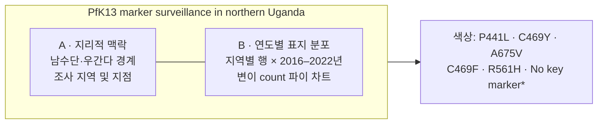
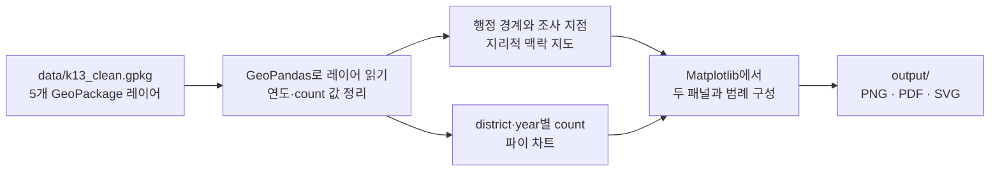

# QGIS to GeoPandas

북부 우간다의 PfK13 감시 지점을 지도에 표시하고, 2016–2022년 지역별 표지 변이 분포를 함께 보여주는 그림을 Python으로 재현하는 프로젝트입니다. 원본 QGIS 프로젝트 없이 GeoPandas와 Matplotlib로 그림을 만들 수 있습니다.

## 결과 그림

생성되는 그림은 왼쪽의 지리적 조사 맥락과 오른쪽의 연도별 변이 분포를 나란히 보여줍니다.



## 처리 흐름



## 프로젝트 파일

재현에 필요한 코드와 데이터, 기존 결과물은 [`k13_python_reproducible.zip`](k13_python_reproducible.zip)에 들어 있습니다.

```text
k13_python_reproducible/
├── make_k13_figure.py        # 지도와 연도별 파이 차트 생성
├── requirements.txt          # Python 패키지 목록
├── README_한국어.md          # 상세 사용 설명
├── data/
│   ├── k13_clean.gpkg        # 지도 경계, 조사 지점 및 차트 데이터
│   └── k13_year_pies_clean.csv
└── output/
    ├── k13_northern_uganda_publication.png
    ├── k13_northern_uganda_publication.pdf
    └── k13_northern_uganda_publication.svg
```

스크립트는 `k13_clean.gpkg`에서 `year_pies`, `surveillance_districts`, `uganda_admin2`, `south_sudan_country`, `bor_context` 레이어를 읽습니다. CSV는 데이터 검토용이며 그림 생성 스크립트에서 직접 사용하지 않습니다.

## 실행 방법

ZIP을 내려받아 압축을 푼 다음, 터미널에서 `k13_python_reproducible` 폴더로 이동합니다.

```bash
python -m venv .venv
```

가상 환경을 활성화하고 필요한 패키지를 설치합니다.

```bash
# macOS / Linux
source .venv/bin/activate

# Windows PowerShell
.venv\Scripts\Activate.ps1
```

```bash
python -m pip install -r requirements.txt
python make_k13_figure.py
```

완료되면 `output/` 폴더에 PNG, PDF, SVG 파일이 생성됩니다. Python 환경에서 GeoPandas 설치가 어려운 경우 conda-forge 환경을 사용할 수 있습니다. 이미 포함된 출력 파일을 열어 결과를 먼저 확인할 수도 있습니다.

## 그림 구성과 조정

- **왼쪽 패널:** 남수단·우간다 행정 경계, 감시 지역과 조사 지점을 표시합니다. Bor 표식은 공개된 도시의 대략적 위치이며 실제 시설 위치가 아닙니다.
- **오른쪽 패널:** 8개 지역을 행으로, 2016–2022년을 열로 배치해 PfK13 표지별 count를 파이 조각으로 나타냅니다. 자료가 없는 연도는 비워 둡니다.
- **색상, 지역 순서, 지도 범위, 파이 크기, 출력 크기와 해상도:** `make_k13_figure.py`의 `colors`, `district_order`, `ax.set_xlim`/`ax.set_ylim`, `Wedge`/`Circle` 반지름, `figsize`, `dpi` 값을 조정합니다. 수정 후 스크립트를 다시 실행하세요.

## 데이터 해석 시 주의

그림의 회색 **No key marker*** 조각은 변이별 분모가 서로 다른 자료에서 계산한 시각화용 근사치입니다. 확정된 wild-type 비율이나 환자별 상호배타적 유전자형 분포를 뜻하지 않습니다. 파이 차트는 변이 count를 기술적으로 요약한 것이며, 변이별 유병률을 직접 비교하려면 분모를 고려한 별도 분석이 필요합니다.

논문이나 보고서에 사용하기 전 연구 범위, 행정 경계의 버전, 원자료와 분모, 그림 설명 및 출처를 검증하세요. 코드의 그림 부제는 Conrad et al.의 NEJM 보충자료 Table S3를 바탕으로 했음을 표시합니다.
